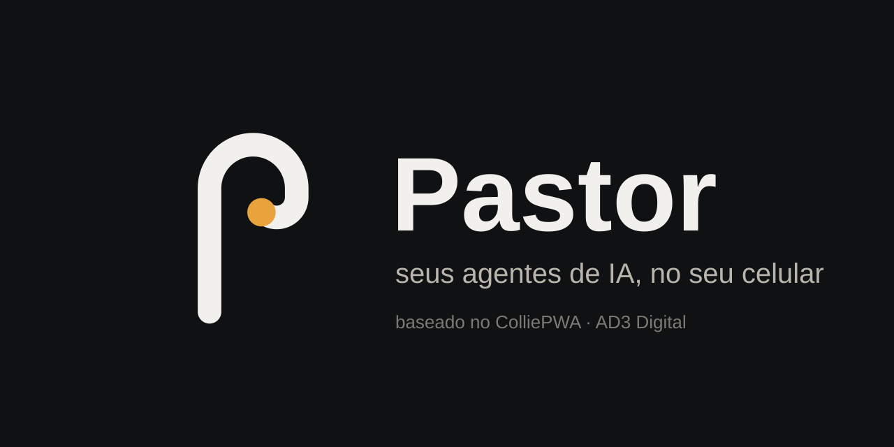

# Pastor

<p align="center">
  
</p>

O Pastor coloca no seu celular os agentes de IA que estão rodando no seu computador (Claude Code,
Codex, OpenCode, pi, omp). Você vê qual agente está esperando por você, lê o que ele escreveu e
responde pelo teclado do celular, de qualquer lugar, pelo [Tailscale](https://tailscale.com).
Os agentes rodam dentro do [Herdr](https://herdr.dev).

> **Note.** O Pastor é um fork do [ColliePWA](https://github.com/AltanS/collie), de Altan Sarisin,
> licenciado em MIT. Não é um projeto oficial do ColliePWA. O nome e o logo do ColliePWA pertencem
> ao autor original; por isso este fork tem nome e cajado próprios. Mantido pela AD3 Digital.

## O que muda em relação ao ColliePWA

Esta é a linha 1.21 do ColliePWA, a última em que o acesso pelo Tailscale funcionava sem pedir login
a toda hora, com estes acréscimos:

- **Pareamento por passkey.** Um aparelho já pareado registra uma passkey e depois entra sozinho,
  sem digitar código de novo.
- **Ligação ao vivo com o Codex e o OMP.** Você fala no celular, o agente trabalha no PC e a
  resposta volta falada. Veja [Ligação ao vivo](#ligação-ao-vivo-fale-com-o-codex-pelo-celular).
- **Nome, ícone e textos do Pastor.** O atualizador busca as versões deste repositório.
- **Funciona com o Herdr app.** O Pastor mostra no celular os terminais do Herdr app, no Windows
  e no Linux, sem precisar do Herdr de terminal.
- **Em português do Brasil.** O app segue o idioma do celular, e o instalador e os comandos do
  dia a dia (`start`, `status`, `pair`, `update`) falam português no terminal.

## Instalar no Windows

Você precisa do Windows 11, do [Herdr](https://herdr.dev) (o Herdr app serve) e do
[Tailscale](https://tailscale.com/download) no PC e no celular, logados na mesma conta.

1. Abra o Herdr app e deixe aberto, com o seu agente (Codex, Claude Code) numa aba.

2. Instale o Pastor:

   ```powershell
   irm https://raw.githubusercontent.com/Ad3Digital/pastor/main/scripts/install.ps1 | iex
   ```

3. Abra um terminal **novo** e ligue o Pastor. Ele acha o Herdr app sozinho:

   ```powershell
   pastor start
   ```

4. No painel do Tailscale, em [DNS](https://login.tailscale.com/admin/dns), ligue **MagicDNS** e
   **Enable HTTPS**.

5. Publique o Pastor na sua rede do Tailscale (copie o bloco inteiro):

   ```powershell
   tailscale serve --bg --set-path=/ 8787
   $nome = (tailscale status --json | ConvertFrom-Json).Self.DNSName.TrimEnd('.')
   $cfg = "$env:APPDATA\herdr\plugins\config\ad3.pastor"
   New-Item -ItemType Directory -Force $cfg | Out-Null
   Add-Content "$cfg\.env" "PASTOR_PUBLIC_HOSTS=$nome`nPASTOR_PUBLIC_URL=https://$nome"
   pastor restart
   pastor url
   ```

6. Abra no celular o endereço que o `pastor url` mostrou e adicione à tela inicial.

7. Pareie o celular: rode `pastor pair` no PC e digite o código (ou leia o QR) no celular.

O Windows pode avisar que o `pastor.exe` não é assinado. Clique em **Mais informações** e depois em
**Executar assim mesmo**. Detalhes e problemas comuns: [docs/windows.md](docs/windows.md).

> **Note.** Usa o Herdr de terminal em vez do app? Rode `herdr` num terminal e deixe aberto antes do
> `pastor start`. Com os dois abertos, o `pastor start` pergunta qual mostrar.

## Instalar no Linux

```bash
curl -fsSL https://raw.githubusercontent.com/Ad3Digital/pastor/main/scripts/install.sh | sh
pastor start
pastor pair
```

O `pastor start` já publica o endereço no Tailscale. Se o Herdr for o seu multiplexador, também dá
para instalar como plugin:

```bash
herdr plugin install Ad3Digital/pastor
herdr plugin action invoke start --plugin ad3.pastor
```

No macOS não há binário pronto neste fork: instale como plugin do Herdr (acima). Mais opções em
[docs/install.md](docs/install.md).

## Ligação ao vivo: fale com o Codex pelo celular

Abra um painel do Codex no Pastor e toque em **Ligação ao vivo** e depois em **Começar ligação**.
Você fala o que quer, o Codex faz no computador e a voz conta o resultado quando ele termina.

- Funciona no Windows, no Linux e no macOS. O áudio vai do celular direto para a OpenAI; o PC só
  digita o seu pedido no painel do Codex e lê a resposta final dele.
- Usa o login do ChatGPT que o Codex já tem no PC (`codex login`). Nada de chave de API.
- Deixe a tela do celular aberta durante a ligação. Com o celular bloqueado a ligação pode cair.

Para o OMP, ligue a extensão uma vez e abra um OMP novo no Herdr:

```bash
bash omp/enable.sh
```

No Windows: `.\omp\enable.ps1`. Para desligar: `bash omp/enable.sh --off`.

> **Note.** A ligação usa o mesmo canal de voz em tempo real que o Codex Desktop e o `/live` do OMP
> usam, com a sua conta do ChatGPT.

## Atualizar e remover

```bash
pastor update
pastor uninstall
```

## Documentação

A documentação técnica, em inglês, está em [docs/](docs/): instalação, Windows, segurança,
configuração e solução de problemas.

## Licença

MIT. Veja [LICENSE](LICENSE) e [TRADEMARKS.md](TRADEMARKS.md).
